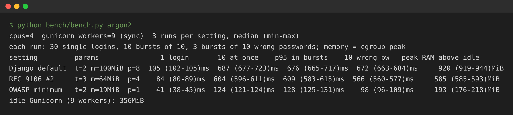
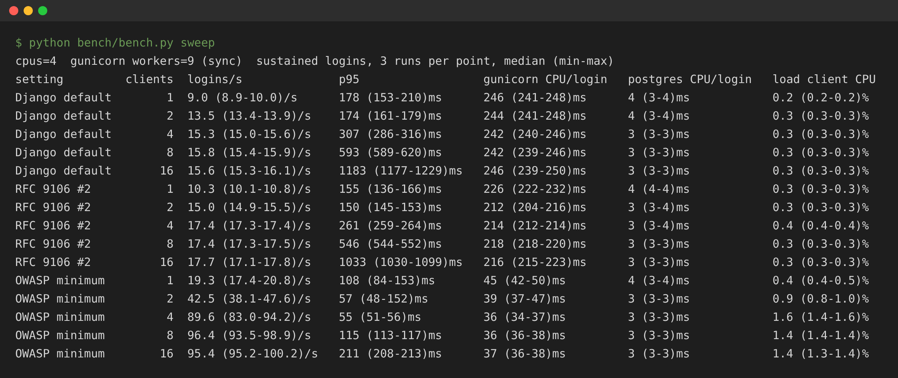
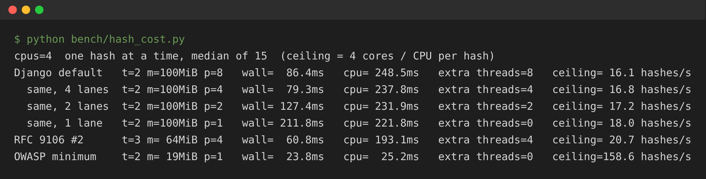
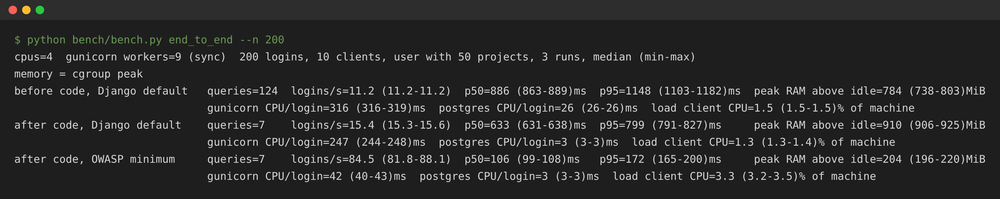

# Ten Logins, One Gigabyte: Benchmarking Django's Argon2 Settings Under Load

> This is the full write-up behind the Medium article: complete methodology, every result with its range, and the measurement caveats.

*I removed 117 database queries from a Django login endpoint, and its throughput in my test rose 1.4×. Then I changed three numbers in the Argon2 password hasher, and it rose another 5.5×. This article reports what Argon2 cost on one 4-CPU server when many people logged in at once, explains what those measurements do and do not show, and walks through choosing settings deliberately. The numbers are evidence from one experiment, not guarantees for your servers.*

## The surprise

A slow login usually sends you to the database first. That is what I did. The endpoint ran 124 SQL queries for a user with 5 organizations and 50 projects, a textbook N+1 problem. After the fix it ran 7.

Then I tested it the way production uses it: under Gunicorn, with 10 clients logging in continuously. Login still took **633 ms** at the median, and the server handled **15.4 logins per second**. The queries had not been the main cost.

The main cost was the password check. Django's out-of-the-box hasher is PBKDF2, but its documentation recommends Argon2, and many projects switch to it, as this one had. At its default settings, Django's Argon2 hasher uses **100 MiB of memory and 8 lanes for every login**. One login at a time, that is fine. Ten at once on a 4-CPU server, the hashes alone need close to 1 GB of RAM, and every login waits for the others.

With the hasher set to OWASP's published minimum for Argon2id, the same test ran at **84.5 logins per second** with a median of **106 ms**, and needed about a fifth of the memory. Whether that minimum is the *right* setting for you is a separate question, and this article treats it as one.

## Argon2 in one minute

A password hash is supposed to be slow. If your database leaks, an attacker has to guess each password and hash every guess. The more each hash costs, the fewer guesses they can afford.

Argon2 won the Password Hashing Competition in 2015. Django ships an Argon2 hasher: install `argon2-cffi` and list it first in `PASSWORD_HASHERS` (out of the box, Django uses PBKDF2). It makes each hash expensive in two ways: it needs CPU time, and it needs a block of memory that it fills and reads back many times. The memory part is what makes it hard to crack with GPUs and custom chips, which have a lot of cores but little fast memory per core.

You control it with three numbers:

- **`memory_cost`**: memory used by one hash, in KiB. Django's default is 102,400 KiB (100 MiB).

- **`time_cost`**: number of passes over that memory. Django's default is 2.

- **`parallelism`**: number of lanes the memory is divided into; lanes can be filled at the same time. Django's default is 8.

So every login checked by Django's Argon2 hasher at its default settings fills 100 MiB of memory, divided into 8 lanes, and passes over it twice. Django uses the Argon2id variant, which is the one OWASP recommends.

Those defaults are generous, yet one hash on an idle machine still finishes quickly. The reason, measured below, is that argon2-cffi computes the 8 lanes on 8 threads, which spread across idle cores. The question this article answers is what happens when the cores are not idle.

## The test

I used a small sample API with the shape of most B2B backends: users belong to organizations, organizations own projects, and login returns a JWT pair plus the user's organizations and projects.

### Environment

- **Server:** Gunicorn 23 with 9 sync workers, from the usual formula of (2 × CPUs) + 1.

- **Machine:** 4 vCPUs (Intel Xeon @ 2.10 GHz), 16 GB of RAM.

- **Stack:** Python 3.13, Django 5.2, Django REST framework 3.16, simplejwt 5.5, argon2-cffi 23.1, PostgreSQL 16 on the same machine.

- **Django:** `DEBUG = False`, persistent database connections (`CONN_MAX_AGE = 60`).

### Settings compared

- **Django default:** 100 MiB, 2 passes, 8 lanes. `Argon2PasswordHasher` as shipped.

- **RFC 9106 #2:** 64 MiB, 3 passes, 4 lanes. The RFC's recommended option for memory-constrained systems.

- **OWASP minimum:** 19 MiB, 2 passes, 1 lane. From the OWASP Password Storage Cheat Sheet.

### Method

**Every run starts clean:** a fresh Gunicorn, every user's password re-hashed with the setting under test, and every worker warmed through an endpoint that does not hash passwords. There are four benchmarks:

- **Single hash** (`hash_cost.py`): one hash at a time, in-process, on the idle machine. Median of 15 hashes per setting.

- **Bursts** (`bench.py argon2`): 3 runs per setting. Each run does 30 logins one after another, then 10 bursts of 10 logins, then 3 bursts of 10 wrong-password logins. A burst is 10 threads waiting on a `threading.Barrier` and sending at the same instant. Its time is until the last of the 10 finishes.

- **Sweep** (`bench.py sweep`): 3 runs per setting. Each run sends sustained logins at 1, 2, 4, 8 and 16 clients, with 40 to 192 logins per level.

- **End to end** (`bench.py end_to_end`): 3 runs per configuration of 200 logins from 10 clients.

- **How numbers are reported:** benchmark results show the median of 3 independent runs, with the lowest and highest run in brackets. The single-hash figures are medians of 15 hashes. Configuration lists and derived values (estimates, limits, ratios) are calculations, not repeated measurements. Percentiles (p50, p95) are computed over all requests in a run.

- **Memory:** the kernel's own peak counter for a cgroup that holds only Gunicorn (`memory.max_usage_in_bytes`), minus its idle usage. Idle Gunicorn used 331 to 373 MiB, which is not included in "above idle" figures. As a cross-check, summed worker RSS polled every 2 ms read 0 to 12% higher in all 18 runs.

- **CPU:** user plus system time from `/proc`, separately for the Gunicorn workers, all PostgreSQL processes, and the load client.

- **Failures:** the client stops a run on any unexpected HTTP status. No run hit one.

**Limits of this setup.** The load client runs on the same 4 CPUs as the server, because I did not have a second machine. To size that effect instead of guessing, the harness measures the client's own CPU. It used at most 1.6% of the machine at any sweep point and at most 3.5% in any end-to-end run. A separate load generator would hand that CPU to the server, so the capacity figures below could be a few percent higher, and latencies at high load could shift slightly because client threads share the scheduler. PostgreSQL ran on the same machine with a warm cache, so database round trips cost far less than over a network. Treat every number here as a result from this machine and this workload.

## One login is fast. Ten at once are not.



*Bursts benchmark: median of 3 runs (lowest–highest run). Per run, "one login alone" is the median of 30 sequential logins, "10 at once" the median of 10 bursts, and "10 wrong passwords" the median of 3 bursts. "p95 in bursts" covers all 100 burst requests of a run.*

- **Django default:** one login alone 105 ms (102–105); 10 logins at once 687 ms (677–723); p95 in bursts 676 ms (665–717); 10 wrong passwords at once 672 ms (663–684); peak RAM above idle 920 MiB (919–944).

- **RFC 9106 #2:** one login alone 84 ms (80–89); 10 logins at once 604 ms (596–611); p95 in bursts 609 ms (583–615); 10 wrong passwords at once 566 ms (560–577); peak RAM above idle 585 MiB (585–593).

- **OWASP minimum:** one login alone 41 ms (38–45); 10 logins at once 124 ms (121–124); p95 in bursts 128 ms (125–131); 10 wrong passwords at once 98 ms (96–109); peak RAM above idle 193 MiB (176–218).

Every login figure includes about 13 ms for the rest of the request: database queries and building the response.

**A busy moment cost 6.5× a quiet one.** With the defaults, one login took 105 ms. When ten arrived together, the last finished after 687 ms. Nothing is broken; the 4 CPUs are doing ten hashes' worth of work.

**Testing one login at a time understated the difference.** Alone, the OWASP minimum was 2.6× faster than the default. Ten at once, it was 5.5× faster.

**Wrong passwords cost nearly the same.** Django checks a wrong password with the same hash, and for an email that does not exist it runs one dummy hash. Ten failed logins at once took 672 ms with the defaults, against 687 ms for ten successful ones. Anyone can generate that load without knowing a single password. These are full-request times, not hash times: a failed login skips the audit write, the token and the response payload, which is why the gap is wider with the cheap OWASP hash (98 ms against 124 ms). The dummy hash narrows account-enumeration timing differences, but it does not guarantee identical response times.

**Memory scaled with logins in flight.** Ten simultaneous logins pushed Gunicorn 920 MiB above its idle 356 MiB, about 1.25 GiB in total. On a 1 GiB container, that is enough to get workers killed for running out of memory.

## How many passwords can one server check?

Ten logins at once is one moment. To find the server's limit, I ran sustained logins with 1, 2, 4, 8 and 16 clients, each sending its next login as soon as the last one returned.



*Sweep benchmark: median of 3 runs (lowest–highest run) at each point.*

Every setting hits a ceiling, and adding clients past it only adds waiting. With the defaults, p95 latency doubles each time the clients double past 4: 307 ms, then 593 ms, then 1,183 ms.

### Is the ceiling real, or an artefact of the test?

Because the load client shared the machine, I checked the ceilings against the server's own CPU cost. If each login costs C seconds of CPU across Gunicorn and PostgreSQL, 4 cores can serve at most 4 ÷ C logins per second. This is an upper limit derived from the server's measured CPU consumption, not a universal ceiling. It assumes the work is CPU-bound, that all 4 cores are available to Gunicorn and PostgreSQL (the load client took 1.4% of the machine or less at these points), and that C stays as measured under this load:

- **Django default:** measured 15.8 logins/s (15.4–15.9) at 8 clients; CPU per login 242 + 3 ms (Gunicorn + PostgreSQL); CPU limit 16.3/s; measured is 97% of the limit.

- **RFC 9106 #2:** measured 17.4/s (17.3–17.5); CPU per login 218 + 3 ms; CPU limit 18.1/s; 96% of the limit.

- **OWASP minimum:** measured 96.4/s (93.5–98.9); CPU per login 36 + 3 ms; CPU limit 102.6/s; 94% of the limit.

The server reached 94–97% of what its own CPU cost allows, while the load client used 1.4% of the machine or less at these points. The ceilings are the server running out of CPU, not the client running out of steam. A separate load-generator machine would likely raise them by a few percent, not change the picture.

This ceiling is the number to plan with: about 16 logins per second for the whole 4-CPU server with Django's defaults, against about 96 with the OWASP minimum. Because wrong passwords cost nearly the same, it is also roughly the rate at which anyone can keep your login endpoint saturated.

## Reading the numbers carefully

### Lanes spread the work; they do not reduce it

`parallelism` sets the number of **lanes**. Argon2 divides its memory into that many lanes, which can be filled at the same time; each pass is split into four slices, and the lanes synchronize at the end of each slice. Changing the lane count changes the hash itself, so it is a security parameter as well as a performance one. How many **threads** compute those lanes is up to the implementation. To see what argon2-cffi does, I timed one hash at a time on the idle machine and counted the threads it started:



```
100 MiB, 2 passes          wall      CPU       threads started
1 lane                     212 ms    222 ms    0 (caller's thread)
2 lanes                    127 ms    232 ms    2
4 lanes                     79 ms    238 ms    4
8 lanes (Django default)    86 ms    249 ms    8
```

Three things follow from this, for argon2-cffi 23.1 on this machine:

- **argon2-cffi starts one thread per lane.** With 1 lane it hashes on the calling thread.

- **More lanes do not reduce the work.** CPU time stays between 222 and 249 ms, rising slightly as lanes are added, probably from the extra coordination between threads.

- **More lanes only shorten the wall time, and only while cores are free.** 4 lanes cut it from 212 to 79 ms. On this four-core machine, 8 lanes were no faster than 4 in this single-hash test.

On a busy server, no core is free, so each login costs its CPU time, not its idle wall time. That gives a rough upper limit on hashes per second: **cores ÷ CPU time per hash**. For this 4-CPU machine, that is about 16 per second with Django's default (4 ÷ 0.249 s), 21 with RFC 9106 #2, and 159 with the OWASP minimum, before counting anything else a login does. The sweep above measured CPU per complete login under load and found the server reaching 94–97% of the limit that implies. The two measurements come from different processes and tools, so expect a few percent of disagreement between them: under load, a whole login with the defaults measured 245 ms of CPU, slightly less than the 249 ms of one isolated hash.

### A first-order memory budget

Each hash holds its full `memory_cost` while it runs. With sync workers, each Gunicorn worker handles one request at a time, so at most one hash per worker runs at once. That gives an estimate of the memory the hashes need:

> hash memory ≈ workers × memory_cost

```
Setting          Estimate (9 workers)   Measured peak above idle
Django default   900 MiB                920 MiB (919–944)
RFC 9106 #2      576 MiB                585 MiB (585–593)
OWASP minimum    171 MiB                193 MiB (176–218)
```

The estimate covers the hashes, not the container. Add your application's idle memory (331 to 373 MiB here), other processes, and headroom, then compare the total with your memory limit. If you run Gunicorn's `gthread` worker, an async server, or several replicas on one host, replace "workers" with the number of requests that can run at once on that host. That number is usually larger.

## Choosing your parameters

The goal is not the fastest hash. It is **the strongest setting your servers can run at peak load**. Treat OWASP's minimum (19 MiB, 2 passes, 1 lane) as the floor, not the target, and work up from it:

- **Set a budget.** Decide the login latency you accept at peak (for example, p95 under 500 ms) and the memory the hashes may use per host.

- **Measure your peak.** Estimate logins per second per server at your busiest time, including failed attempts.

- **Benchmark candidates on your hardware.** Start at the OWASP minimum and add stronger options, such as RFC 9106's 64 MiB setting or more memory at 1 lane.

- **Pick the strongest setting that fits.** On this test server, RFC 9106 #2 tops out near 17 logins per second. That is enough if a server sees 5 logins per second at peak, and too little if it sees 20.

Whichever numbers you choose, Django needs a five-line subclass. Here it is with the OWASP minimum:

```
# accounts/hashers.py
from django.contrib.auth.hashers import Argon2PasswordHasher

class TunedArgon2PasswordHasher(Argon2PasswordHasher):
    time_cost = 2
    memory_cost = 19 * 1024   # in KiB, so 19 MiB
    parallelism = 1
```

Put it first in `PASSWORD_HASHERS`. Django hashes new passwords with the first entry and uses the rest to check older hashes:

```
PASSWORD_HASHERS = [
    "accounts.hashers.TunedArgon2PasswordHasher",
    "django.contrib.auth.hashers.Argon2PasswordHasher",
    "django.contrib.auth.hashers.PBKDF2PasswordHasher",
]
```

### Existing users are upgraded on their next login

You do not need a data migration. Every Argon2 hash records the parameters it was made with. When a user logs in successfully, Django checks the password with the stored parameters, sees that they differ from the preferred hasher's, and saves a new hash. I verified this on the sample app:

```
before:      m=102400,t=2,p=8
after login: m=19456,t=2,p=1
```

The first login after the change is slower, because it checks once with the old settings and hashes once with the new ones. Users who do not log in keep their old hash until they do. That leaves a timing gap while the upgrade runs: Django's Argon2 hasher does not pad its runtime (its `harden_runtime()` method is empty), so a login for an account still on the old, more expensive hash takes longer than one for an email that does not exist, which only costs the new, cheaper dummy hash. Rate limiting matters most during this window.

## The database fix vs the hashing fix

Back to where this started. I ran 200 logins from 10 continuous clients, all for the user with 50 projects, three times each:

- **Original code** (124 queries) with Django's default Argon2.

- **Query fix** (7 queries) with Django's default Argon2.

- **Query fix** with the OWASP-minimum hasher.

The query fix was the standard cure for N+1: load memberships with `select_related()`, load all project memberships in one more query, and group them in Python. The JSON response stayed identical.



*End-to-end benchmark: median of 3 runs (lowest–highest run), 200 logins from 10 clients per run.*

- **Original code, Django default:** 124 queries; 11.2 logins/s (11.2–11.2); median 886 ms (863–889); p95 1,148 ms (1,103–1,182); CPU per login 316 + 26 ms (Gunicorn + PostgreSQL); peak RAM above idle 784 MiB (738–803).

- **Query fix, Django default:** 7 queries; 15.4 logins/s (15.3–15.6); median 633 ms (631–638); p95 799 ms (791–827); CPU per login 247 + 3 ms; peak RAM above idle 910 MiB (906–925).

- **Query fix, OWASP minimum:** 7 queries; 84.5 logins/s (81.8–88.1); median 106 ms (99–108); p95 172 ms (165–200); CPU per login 42 + 3 ms; peak RAM above idle 204 MiB (196–220).

In this test, removing 117 queries raised throughput **1.4×**. Changing the hasher raised it a further **5.5×**, or **7.5×** in total.

The CPU figures explain both steps. The query fix cut CPU per login from 342 to 250 ms, a ratio of 1.37, and throughput rose 1.38×. The hasher change cut it from 250 to 45 ms, a ratio of 5.6, and throughput rose 5.5×. This holds only because the server was out of CPU and every request had the same shape. Where database waits, network latency, rate limits or other non-CPU limits dominate, throughput will not track CPU per request.

That split describes this test, not a law. Here the database was local, with a warm cache. With a remote, busier database, the 124 round trips would cost far more wall time, and the query fix would be worth more.

One detail is worth noticing. The query fix made peak memory go *up*, from 784 to 910 MiB, and the three runs of each did not overlap. That is consistent with requests spending less time in the database and so overlapping more in the hasher, where each holds 100 MiB. Speeding up one part of a request can move pressure onto the next bottleneck.

## What you trade, and what else to put in place

The OWASP minimum is a published baseline. It is not proof that it suits every application. The cost of a hash protects your users *after* a breach, when an attacker guesses passwords offline. A cheaper hash lets them try more guesses per second, so every step down from the defaults gives some of that protection away. How much you need depends on what the accounts protect, how strong your users' passwords are, and who would attack them. For high-value accounts, the stronger end of the range is worth paying for, in hardware if necessary.

Keep the two questions apart. The benchmarks in this article rank the candidates by cost on this server; they say nothing about how much security each one buys. That judgement comes from your threat model and from published guidance such as OWASP's and RFC 9106's.

The hash settings are also only one control. Whatever you choose:

- **Rate-limit login.** Wrong passwords cost nearly as much as right ones. Limit attempts per IP address and per account, so neither password guessing nor plain floods can use up your hashing capacity.

- **Budget memory per host, not per process.** Workers × memory per hash, for every Gunicorn process and replica on the host, plus their idle memory.

- **Bound concurrency deliberately.** Gunicorn's sync workers cap how many hashes run at once. If you change the worker class or add replicas, recompute the budget.

- **Load-test across a range, not one point.** Find where latency, memory and errors become unacceptable, as in the 1-to-16-client sweep above.

- **Revisit the choice.** Hardware gets faster for you and for attackers. Re-run the benchmark when you change instance types.

## Takeaways

These are findings from one experiment on one 4-CPU machine. The method transfers; the exact numbers will not.

- **Benchmark the password hasher under concurrency.** One login at a time, Django's default Argon2 setting looked 2.6× slower than the OWASP minimum. Ten at once, it was 5.5× slower.

- **Lanes spread a hash across cores; they do not reduce its work.** When the server is busy, what each login costs is its CPU time.

- **Know your ceiling.** Cores ÷ CPU per login predicted this server's limit within 3–6%: about 16 logins per second with the defaults.

- **Budget memory as workers × memory per hash, plus idle memory.** Here that was about 0.9 GiB for the hashes on top of 0.35 GiB idle.

- **Failed logins cost nearly as much as successful ones.** Rate limiting is part of capacity planning, not just security.

- **Choose deliberately.** Treat the OWASP minimum as the floor, benchmark stronger options, and pick the strongest one that meets your latency and memory budget at peak.

- **Changing settings is cheap.** A five-line subclass, and Django upgrades each user's hash at their next login.

- **Measure before you optimize.** Removing 117 queries helped, but in this test the hasher was the larger cost by a wide margin.

## Reproduce it yourself

The sample app, the benchmark scripts, the terminal output shown above and the raw results of every run are in this repository. I checked that it runs from a clean checkout: a fresh virtualenv from `requirements.txt`, a new PostgreSQL database, then every benchmark.

Requirements: Linux (the scripts read `/proc`), Python 3.12 or newer, and a local PostgreSQL. The kernel memory peak needs root and the cgroup v1 memory controller. Without them, the scripts fall back to summed worker RSS and say so in their output.

```
python -m venv .venv && .venv/bin/pip install -r requirements.txt
.venv/bin/python manage.py migrate && .venv/bin/python manage.py seed

.venv/bin/python bench/hash_cost.py                    # one hash: wall, CPU, threads
.venv/bin/python bench/bench.py argon2                 # bursts, 3 runs per setting
.venv/bin/python bench/bench.py sweep                  # 1 to 16 clients, 3 runs per setting
.venv/bin/python bench/bench.py end_to_end --n 200
.venv/bin/python bench/bench.py sweep --from-results   # reprint a table from raw results
```

Every run appends one JSON line per measurement to `bench/results.jsonl`, including the RSS cross-check for each memory figure and the CPU split between Gunicorn, PostgreSQL and the load client. The full run takes about 30 minutes on a 4-CPU machine. Run nothing else on the machine meanwhile: during my first full run, generating a screenshot in parallel visibly inflated one run's p95, and I reran that benchmark.

## References

- [OWASP Password Storage Cheat Sheet](https://cheatsheetseries.owasp.org/cheatsheets/Password_Storage_Cheat_Sheet.html): the Argon2id minimum used here.

- [RFC 9106: Argon2 Memory-Hard Function](https://www.rfc-editor.org/rfc/rfc9106): the algorithm, its parameters and the recommended settings.

- [Django documentation: password management](https://docs.djangoproject.com/en/5.2/topics/auth/passwords/): `PASSWORD_HASHERS`, the Argon2 hasher and password upgrading.
